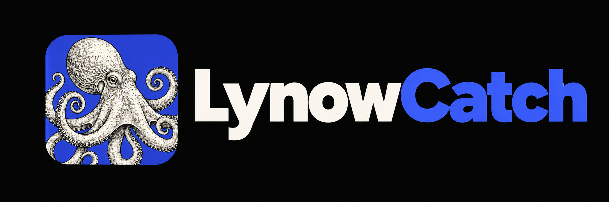
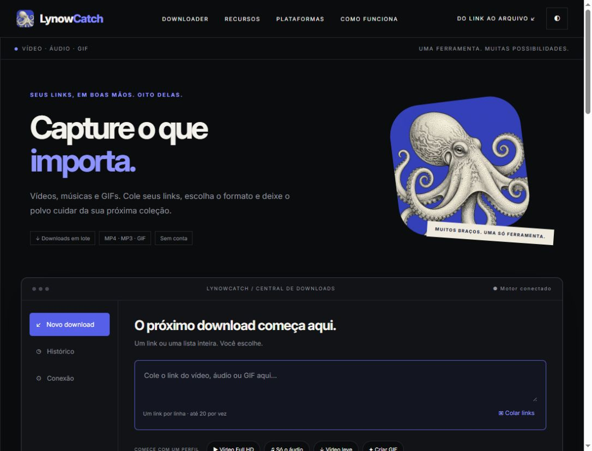
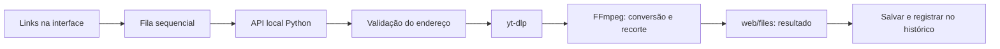

<p align="center"></p>

<p align="center"><b>Muitos braços. Uma só ferramenta.</b><br>Uma central local para transformar links em vídeo, áudio e GIF.</p>
<p align="center">Python 3.10+ · yt-dlp · FFmpeg · Interface em português · v0.2.0</p>

## Sobre

O LynowCatch reúne seus links em uma fila e executa downloads e conversões no seu computador. Escolha um perfil, consulte as informações da mídia, recorte um trecho e guarde o resultado. Não exige conta e não envia seus arquivos a um serviço de armazenamento do LynowCatch. A extração acessa a plataforma de origem pela sua conexão.

A identidade usa um polvo em gravura, azul e tons de papel. A organização deste repositório e a apresentação do produto têm como referência o [LynowCut](https://github.com/arthurlynow098/LynowCut), de Arthur Entsev, com os créditos preservados.



## Comece aqui

1. Instale Python 3.10 ou mais recente.
2. Instale FFmpeg e ffprobe. No Windows: `winget install --id Gyan.FFmpeg --exact`.
3. Execute **INICIAR.bat**. Ele cria `.venv` e instala as dependências Python.
4. Abra **http://localhost:8765**. Confira o estado do motor na aba **Conexão**.
5. Cole seus links, escolha formato e qualidade e clique em **Adicionar à fila**.
6. Quando terminar, clique em **Salvar**.

### Instalação manual

```powershell
py -m venv .venv
.\.venv\Scripts\python.exe -m pip install -r requirements.txt
.\.venv\Scripts\python.exe server.py
```

Linux e macOS: use `python3 -m venv .venv`, `.venv/bin/python -m pip install -r requirements.txt` e `.venv/bin/python server.py`, com FFmpeg e ffprobe no PATH.

## Recursos

| Recurso | Comportamento |
|---|---|
| Downloads em lote | Até 20 links por adição; processamento sequencial. |
| Vídeo MP4 | Escolha 480p, 720p, 1080p ou 2160p, conforme a fonte. |
| Áudio MP3 | Extração de áudio com FFmpeg. |
| GIF | Até 15 segundos, 12 fps e largura de 480 pixels. |
| Original | Download sem conversão solicitada; não permite recorte. |
| Perfis rápidos | Full HD, só áudio, vídeo leve e GIF. |
| Recorte | Início e duração em segundos; aplicado após o download. |
| Prévia | Consulta título, autor, duração e extrator do primeiro link. |
| Controle da fila | Pausa dos próximos itens, remoção de pendentes, nova tentativa e limpeza dos concluídos. |
| Histórico | Até 100 registros no navegador, pesquisa e repetição do download. |
| Relatório CSV | Exportação dos links, formatos, qualidades, datas e tamanhos. |
| Preferências | Tema, formato, qualidade e endereço do motor guardados no navegador. |
| Diagnóstico | Estado do motor, yt-dlp, FFmpeg e ffprobe via API. |
| Interface adaptável | Layout para desktop e celular; uso do motor no próprio computador. |

## Como funciona



A interface é HTML, CSS e JavaScript sem dependências de build. O servidor usa a biblioteca padrão do Python e escuta exclusivamente em `127.0.0.1:8765`. O módulo `lynowcatch/engine.py` concentra validações, consulta e processamento. Cada resultado recebe uma pasta com identificador próprio.

## Estrutura

```text
LynowCatch/
├── lynowcatch/
│   ├── __init__.py          Versão do produto
│   └── engine.py            Validação e processamento
├── web/
│   ├── index.html           Interface e estilos
│   ├── app.js               Fila, histórico e comunicação
│   ├── styles.css           Estilos e layout adaptável
│   ├── octopus.png          Mascote original
│   ├── Inter.ttf            Tipografia
│   └── Inter-LICENSE.txt    Licença da fonte
├── tests/test_engine.py     Testes do motor
├── docs/                   API, arquitetura e uso
├── .github/workflows/      Validação automática
├── server.py               Entrada do servidor
├── INICIAR.bat             Iniciador Windows
├── requirements.txt        Dependência de extração
├── CHANGELOG.md            Histórico de versões
├── CONTRIBUTING.md         Guia de contribuição
└── LICENSE-LynowCut         Créditos e licença da referência
```

`web/files`, `.venv`, logs e a cópia de referência não entram no versionamento. A imagem original mantém seu arquivo intacto; o recorte visual da borda é aplicado por CSS.

## Testes

```powershell
.\.venv\Scripts\python.exe -m unittest discover -s tests -v
node --check web/app.js
```

Os testes validam endereços privados e mistos, opções inválidas, limpeza de downloads interrompidos e os argumentos do recorte GIF, sem depender de plataformas externas. O GitHub Actions executa os testes em Windows e Linux. A disponibilidade de cada plataforma deve ser verificada separadamente.

## Limites e comportamento

- Arquivo final de até **500 MB**. O yt-dlp também recebe esse limite, mas uma fonte pode não informar seu tamanho antecipadamente.
- Download com tempo limite de **10 minutos**. Conversão ou recorte adicional: até **10 minutos**.
- Recorte com início de até 86400 segundos e duração solicitada de até 3600 segundos; GIF limitado a 15 segundos.
- Pausar deixa o item em processamento terminar. Não há cancelamento do subprocesso pela interface.
- A fila é da sessão e se perde ao recarregar. O histórico permanece no navegador.
- A barra mostra a proporção de itens concluídos, não a porcentagem de transferência de um arquivo.
- Excluir o histórico não apaga arquivos. Apagar `web/files` libera espaço e invalida links antigos.
- Não há garantia de suporte a todos os sites; disponibilidade, região e alterações nas plataformas afetam a extração.
- Conteúdo privado, DRM, autenticação e playlists não fazem parte desta versão.
- Validação do endereço inicial não é isolamento de rede: redirecionamentos e requisições internas dos extratores dependem do yt-dlp. Não exponha o motor como serviço público.

## Documentação

- [Guia de uso e diagnóstico](docs/GUIA.md)
- [API local](docs/API.md)
- [Arquitetura e decisões](docs/ARQUITETURA.md)
- [Direção do produto](PRODUTO.md)
- [Mudanças](CHANGELOG.md)
- [Contribuição](CONTRIBUTING.md)

## Créditos

Referência visual e documental: **[LynowCut](https://github.com/arthurlynow098/LynowCut)**, © 2026 Arthur Entsev, licença MIT preservada em [LICENSE-LynowCut](LICENSE-LynowCut). A fonte Inter mantém sua licença SIL Open Font License em [web/Inter-LICENSE.txt](web/Inter-LICENSE.txt). yt-dlp e FFmpeg têm suas próprias licenças e não estão incorporados neste repositório. Veja [THIRD_PARTY_NOTICES.md](THIRD_PARTY_NOTICES.md).
